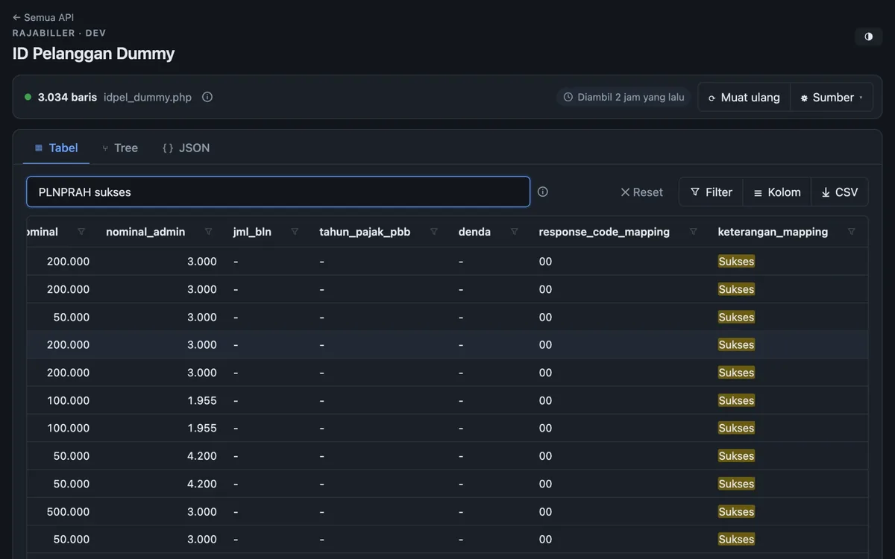

# ID Pelanggan Dummy Rajabiller — Search & Viewer untuk Testing Integrasi API PPOB / H2H

> Cari **ID pelanggan dummy Rajabiller** (`idpel_dummy`) dengan cepat saat sedang **integrasi API Rajabiller**
> (Host to Host / H2H) di environment development — PLN prabayar & pascabayar, PDAM, BPJS, Telkom,
> multifinance, dan produk PPOB lainnya.

← [Kembali ke README](../README.md)

### 🌐 Langsung pakai — tanpa setup

**👉 [https://rajabiller-dummy-id-pelanggan-searc.vercel.app/rajabiller-dummy-id-pelanggan/](https://rajabiller-dummy-id-pelanggan-searc.vercel.app/rajabiller-dummy-id-pelanggan/)**

Buka link di atas di browser, tidak perlu clone repo, `npm install`, atau menjalankan server sendiri.
Contoh langsung filter produk: [`?prefix=PLNPRAH`](https://rajabiller-dummy-id-pelanggan-searc.vercel.app/rajabiller-dummy-id-pelanggan/?prefix=PLNPRAH).
Link lama di root (`/?prefix=…`) otomatis diteruskan ke halaman ini.

## Tentang

**Rajabiller** adalah *biller aggregator* / supplier multi biller **Host to Host (H2H)** untuk layanan
**PPOB** (Payment Point Online Bank) di Indonesia, bagian dari grup PT Bimasakti Multi Sinergi. Saat
integrasi dengan API Rajabiller, developer butuh **ID pelanggan (IDPEL) dummy / data testing** per produk
untuk mencoba transaksi *inquiry* dan *payment* di server development. Daftar itu tersedia di endpoint
`idpel_dummy.php`, tapi berupa JSON panjang yang sulit dibaca — halaman ini membuatnya mudah dicari.

Halaman ini menampilkan data dari `https://c-dev-api.rajabiller.com/idpel_dummy.php`
(opsional `?prefix=PLNPRAH`) dalam bentuk **Table**, **Tree**, dan **JSON**.

| | |
| --- | --- |
| Halaman | `/rajabiller-dummy-id-pelanggan/` |
| Endpoint | `https://c-dev-api.rajabiller.com/idpel_dummy.php` |
| Filter API | `prefix` — kode produk, mis. `PLNPRAH` |
| Konfigurasi | `rajabiller` di `src/sources.js` |

**Cocok untuk kamu yang mencari:** `id pelanggan dummy rajabiller`, `idpel dummy rajabiller`,
`data testing api rajabiller`, `sandbox rajabiller`, `contoh id pelanggan PLN prabayar untuk testing`,
`dummy idpel PPOB`, `integrasi H2H rajabiller`.

## FAQ

**Apa itu ID pelanggan dummy Rajabiller?**
ID pelanggan (IDPEL / nomor pelanggan) khusus testing yang disediakan Rajabiller di server development
(`c-dev-api.rajabiller.com`) agar mitra bisa mencoba alur inquiry → payment tanpa transaksi sungguhan.

**Bagaimana mencari ID pelanggan dummy untuk produk tertentu (misal PLN prabayar)?**
Isi prefix/kode produk (contoh `PLNPRAH`) di form atau buka `/rajabiller-dummy-id-pelanggan/?prefix=PLNPRAH`, lalu cari
di Table View atau telusuri per kategori di Tree View.

**Kenapa request langsung ke endpoint gagal di browser?**
Biasanya karena CORS. Aplikasi otomatis memakai endpoint `/proxy` sebagai cadangan (lihat bagian Menjalankan di README).

**Muncul error `proxy: HTTP 403` di versi online, padahal endpoint bisa dibuka manual di browser?**
Endpoint ini tidak mengirim header CORS, jadi browser menolak halaman membaca isinya walau status 200. Proxy di Vercel
juga ditolak (403) oleh firewall Cloudflare server Rajabiller karena request datang dari datacenter. Solusinya:
buka endpoint di tab baru (link tersedia di ⓘ detail status), salin seluruh JSON-nya, lalu pakai **Tempel JSON**
(atau simpan sebagai file lalu **File**). Data akan tersimpan di browser untuk kunjungan berikutnya. Alternatif:
jalankan `npm run dev` / `npm start` di komputer sendiri supaya proxy memakai jaringan Anda.

**Apakah ini repo resmi Rajabiller?**
Bukan. Ini tool bantu (unofficial) untuk developer yang sedang integrasi. Untuk dokumentasi API, kredensial,
dan kode produk resmi, hubungi tim Rajabiller.

## Kata kunci

rajabiller · api rajabiller · integrasi rajabiller · h2h rajabiller · id pelanggan dummy · idpel dummy ·
idpel_dummy.php · data testing ppob · sandbox ppob · biller aggregator indonesia · PLN prabayar ·
PLN pascabayar · PDAM · BPJS · Telkom · multifinance
